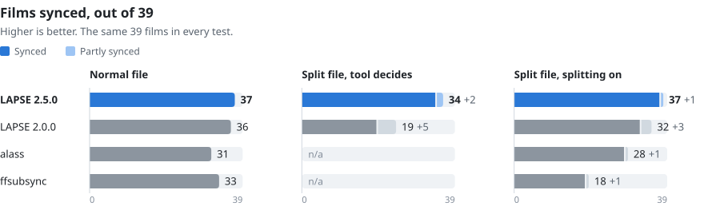
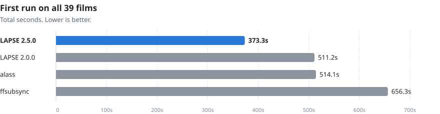
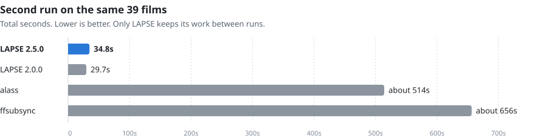

# Benchmarks

LAPSE 2.5.0 and 2.0.0 tested against alass 2.0.0 and ffsubsync 0.5.1 on 39
feature films, plus one test with a subtitle that belongs to a different film.

> [!NOTE]
> The 39 films were picked because they are hard to sync: long running times,
> long silent stretches, loud music under the dialogue, and films with more than
> one cut. Every tool scores lower here than it would on an ordinary library.
> 39 films is also a small sample, so a gap of one or two films between tools
> says little. See [About the test set](#about-the-test-set).

## LAPSE 2.5.0 in short

- **37 of 39** films synced when the subtitle was shifted or drifting. 2.0.0 synced 36.
- **34 of 39** films synced when the subtitle was cut in several places and
  LAPSE had to find that out by itself. 2.0.0 synced 19.
- **37 of 39** with splitting turned on. That is the best result of any tool
  in the test.
- **373 seconds** for a first run on all 39 films. That is 27% less time
  than 2.0.0 and alass, and 43% less than ffsubsync.
- When LAPSE is unsure, it still leaves the original subtitle alone and tells
  you why.

**Contents**

- [Results at a glance](#results-at-a-glance)
- [Film by film](#film-by-film)
- [Confidence](#confidence)
- [Wrong subtitle](#wrong-subtitle)
- [Error in milliseconds](#error-in-milliseconds)
- [Split test in detail](#split-test-in-detail)
- [What each tool can do](#what-each-tool-can-do)
- [Subtitle formats](#subtitle-formats)
- [About the test set](#about-the-test-set)
- [How the tests were made](#how-the-tests-were-made)
- [Method notes](#method-notes)

## Results at a glance

Films synced out of 39. Partial means some segments of a split file landed and
some did not. The best result in each row is in bold.

| Test | LAPSE 2.5.0 | LAPSE 2.0.0 | alass | ffsubsync |
| ---- | :---------: | :---------: | :---: | :-------: |
| Normal file (shift or drift) | **37** | 36 | 31 | 33 |
| Split file, the tool decides by itself | **34** +2 partial | 19 +5 partial | n/a | n/a |
| Split file, splitting turned on | **37** +1 partial | 32 +3 partial | 28 +1 partial | 18 +1 partial |
| First run, all 39 films | **373.3s** | 511.2s | 514.1s | 656.3s |
| Second run on the same film, all 39 | 34.8s | **29.7s** | about 514s | about 656s |

<picture>
  <source media="(prefers-color-scheme: dark)" srcset="images/benchmark-synced-dark.svg">
  
</picture>

<picture>
  <source media="(prefers-color-scheme: dark)" srcset="images/benchmark-first-run-dark.svg">
  
</picture>

<picture>
  <source media="(prefers-color-scheme: dark)" srcset="images/benchmark-second-run-dark.svg">
  
</picture>

Only LAPSE has a number in the "decides by itself" row. alass runs in split
mode by default, so its one run counts as splitting turned on. ffsubsync never
splits until it is told to. The bottom split row is the fair comparison when
you already know the file is split. The row above it is what happens when you
don't know.

LAPSE saves the speech profile it builds from the audio. The first run on a
film pays for decoding the audio, and every later run on the same film skips
that step. That is the usual case in a library, where you fix one subtitle
track and then another for the same film. alass and ffsubsync start from
scratch every time. They were also run twice, and their second run took about
as long as the first, so the second-run chart and table show their first-run
time. LAPSE 2.5.0 is a little slower than 2.0.0 on a second run, and still
more than ten times faster than alass and ffsubsync.

## Film by film

✅ synced  🟡 partly synced (segments that landed)  ❌ not synced

For the normal files, LAPSE's mark is from the cached run. alass made one run per split file, and
it is shown under "splitting turned on" because split mode is its default.

<table>
<thead>
<tr><th rowspan="2">Film</th><th colspan="4">Normal file</th><th colspan="2">Split file, LAPSE decides</th><th colspan="4">Split file, splitting turned on</th></tr>
<tr><th>LAPSE 2.5.0</th><th>LAPSE 2.0.0</th><th>alass</th><th>ffsub- sync</th><th>LAPSE 2.5.0</th><th>LAPSE 2.0.0</th><th>LAPSE 2.5.0</th><th>LAPSE 2.0.0</th><th>alass</th><th>ffsub- sync</th></tr>
</thead>
<tbody>
<tr><td>2001: A Space Odyssey</td><td align="center">✅</td><td align="center">✅</td><td align="center">✅</td><td align="center">❌</td><td align="center">✅</td><td align="center">✅</td><td align="center">✅</td><td align="center">✅</td><td align="center">✅</td><td align="center">❌</td></tr>
<tr><td>Andrei Rublev</td><td align="center">✅</td><td align="center">✅</td><td align="center">✅</td><td align="center">✅</td><td align="center">✅</td><td align="center">✅</td><td align="center">✅</td><td align="center">✅</td><td align="center">✅</td><td align="center">✅</td></tr>
<tr><td>Apocalypse Now</td><td align="center">✅</td><td align="center">✅</td><td align="center">✅</td><td align="center">✅</td><td align="center">✅</td><td align="center">🟡 2/3</td><td align="center">✅</td><td align="center">✅</td><td align="center">✅</td><td align="center">✅</td></tr>
<tr><td>Badlands</td><td align="center">✅</td><td align="center">✅</td><td align="center">✅</td><td align="center">✅</td><td align="center">✅</td><td align="center">🟡 2/3</td><td align="center">✅</td><td align="center">✅</td><td align="center">✅</td><td align="center">❌</td></tr>
<tr><td>Barry Lyndon</td><td align="center">✅</td><td align="center">✅</td><td align="center">✅</td><td align="center">✅</td><td align="center">✅</td><td align="center">✅</td><td align="center">✅</td><td align="center">✅</td><td align="center">✅</td><td align="center">✅</td></tr>
<tr><td>Blue Velvet</td><td align="center">✅</td><td align="center">✅</td><td align="center">✅</td><td align="center">✅</td><td align="center">✅</td><td align="center">✅</td><td align="center">✅</td><td align="center">✅</td><td align="center">✅</td><td align="center">✅</td></tr>
<tr><td>Brazil</td><td align="center">✅</td><td align="center">✅</td><td align="center">✅</td><td align="center">✅</td><td align="center">✅</td><td align="center">🟡 2/3</td><td align="center">✅</td><td align="center">✅</td><td align="center">✅</td><td align="center">✅</td></tr>
<tr><td>Challengers</td><td align="center">✅</td><td align="center">✅</td><td align="center">✅</td><td align="center">✅</td><td align="center">✅</td><td align="center">✅</td><td align="center">✅</td><td align="center">✅</td><td align="center">✅</td><td align="center">✅</td></tr>
<tr><td>Come and See</td><td align="center">✅</td><td align="center">✅</td><td align="center">❌</td><td align="center">❌</td><td align="center">✅</td><td align="center">❌</td><td align="center">✅</td><td align="center">✅</td><td align="center">❌</td><td align="center">❌</td></tr>
<tr><td>Dancer in the Dark</td><td align="center">✅</td><td align="center">✅</td><td align="center">✅</td><td align="center">✅</td><td align="center">✅</td><td align="center">✅</td><td align="center">✅</td><td align="center">✅</td><td align="center">✅</td><td align="center">❌</td></tr>
<tr><td>Drive</td><td align="center">✅</td><td align="center">✅</td><td align="center">✅</td><td align="center">✅</td><td align="center">✅</td><td align="center">🟡 2/3</td><td align="center">✅</td><td align="center">✅</td><td align="center">✅</td><td align="center">❌</td></tr>
<tr><td>Enter the Void</td><td align="center">✅</td><td align="center">✅</td><td align="center">✅</td><td align="center">✅</td><td align="center">✅</td><td align="center">❌</td><td align="center">✅</td><td align="center">❌</td><td align="center">✅</td><td align="center">❌</td></tr>
<tr><td>Eraserhead</td><td align="center">✅</td><td align="center">✅</td><td align="center">❌</td><td align="center">✅</td><td align="center">🟡 2/3</td><td align="center">❌</td><td align="center">🟡 2/3</td><td align="center">🟡 2/3</td><td align="center">🟡 2/3</td><td align="center">❌</td></tr>
<tr><td>Ex Machina</td><td align="center">✅</td><td align="center">✅</td><td align="center">✅</td><td align="center">✅</td><td align="center">✅</td><td align="center">❌</td><td align="center">✅</td><td align="center">✅</td><td align="center">❌</td><td align="center">✅</td></tr>
<tr><td>Eyes Wide Shut</td><td align="center">✅</td><td align="center">✅</td><td align="center">✅</td><td align="center">✅</td><td align="center">✅</td><td align="center">✅</td><td align="center">✅</td><td align="center">✅</td><td align="center">✅</td><td align="center">✅</td></tr>
<tr><td>Fallen Angels</td><td align="center">✅</td><td align="center">✅</td><td align="center">✅</td><td align="center">✅</td><td align="center">✅</td><td align="center">❌</td><td align="center">✅</td><td align="center">✅</td><td align="center">❌</td><td align="center">❌</td></tr>
<tr><td>Fargo</td><td align="center">✅</td><td align="center">✅</td><td align="center">✅</td><td align="center">✅</td><td align="center">✅</td><td align="center">✅</td><td align="center">✅</td><td align="center">✅</td><td align="center">✅</td><td align="center">✅</td></tr>
<tr><td>Hereditary</td><td align="center">✅</td><td align="center">✅</td><td align="center">✅</td><td align="center">✅</td><td align="center">✅</td><td align="center">✅</td><td align="center">✅</td><td align="center">✅</td><td align="center">✅</td><td align="center">✅</td></tr>
<tr><td>Inland Empire</td><td align="center">✅</td><td align="center">✅</td><td align="center">✅</td><td align="center">✅</td><td align="center">✅</td><td align="center">✅</td><td align="center">✅</td><td align="center">✅</td><td align="center">✅</td><td align="center">❌</td></tr>
<tr><td>Manchester by the Sea</td><td align="center">✅</td><td align="center">✅</td><td align="center">❌</td><td align="center">✅</td><td align="center">❌</td><td align="center">❌</td><td align="center">✅</td><td align="center">❌</td><td align="center">❌</td><td align="center">✅</td></tr>
<tr><td>Mulholland Drive</td><td align="center">✅</td><td align="center">✅</td><td align="center">✅</td><td align="center">✅</td><td align="center">✅</td><td align="center">✅</td><td align="center">✅</td><td align="center">✅</td><td align="center">✅</td><td align="center">❌</td></tr>
<tr><td>No Country for Old Men</td><td align="center">✅</td><td align="center">✅</td><td align="center">✅</td><td align="center">✅</td><td align="center">✅</td><td align="center">✅</td><td align="center">✅</td><td align="center">✅</td><td align="center">✅</td><td align="center">✅</td></tr>
<tr><td>Possession</td><td align="center">✅</td><td align="center">✅</td><td align="center">✅</td><td align="center">✅</td><td align="center">✅</td><td align="center">❌</td><td align="center">✅</td><td align="center">✅</td><td align="center">✅</td><td align="center">❌</td></tr>
<tr><td>Requiem for a Dream</td><td align="center">✅</td><td align="center">✅</td><td align="center">❌</td><td align="center">✅</td><td align="center">✅</td><td align="center">✅</td><td align="center">✅</td><td align="center">✅</td><td align="center">❌</td><td align="center">❌</td></tr>
<tr><td>Saving Private Ryan</td><td align="center">✅</td><td align="center">✅</td><td align="center">✅</td><td align="center">✅</td><td align="center">✅</td><td align="center">❌</td><td align="center">✅</td><td align="center">✅</td><td align="center">✅</td><td align="center">✅</td></tr>
<tr><td>Seven Samurai</td><td align="center">✅</td><td align="center">✅</td><td align="center">✅</td><td align="center">✅</td><td align="center">✅</td><td align="center">✅</td><td align="center">✅</td><td align="center">❌</td><td align="center">❌</td><td align="center">❌</td></tr>
<tr><td>Stalker</td><td align="center">✅</td><td align="center">❌</td><td align="center">✅</td><td align="center">❌</td><td align="center">✅</td><td align="center">✅</td><td align="center">✅</td><td align="center">✅</td><td align="center">✅</td><td align="center">❌</td></tr>
<tr><td>Synecdoche, New York</td><td align="center">✅</td><td align="center">✅</td><td align="center">✅</td><td align="center">✅</td><td align="center">✅</td><td align="center">❌</td><td align="center">✅</td><td align="center">✅</td><td align="center">✅</td><td align="center">❌</td></tr>
<tr><td>The Deer Hunter</td><td align="center">✅</td><td align="center">✅</td><td align="center">✅</td><td align="center">✅</td><td align="center">✅</td><td align="center">🟡 2/3</td><td align="center">✅</td><td align="center">🟡 2/3</td><td align="center">✅</td><td align="center">🟡 2/3</td></tr>
<tr><td>The Godfather</td><td align="center">❌</td><td align="center">❌</td><td align="center">❌</td><td align="center">❌</td><td align="center">❌</td><td align="center">❌</td><td align="center">✅</td><td align="center">✅</td><td align="center">❌</td><td align="center">❌</td></tr>
<tr><td>The Godfather Part II</td><td align="center">❌</td><td align="center">❌</td><td align="center">❌</td><td align="center">❌</td><td align="center">❌</td><td align="center">❌</td><td align="center">❌</td><td align="center">❌</td><td align="center">❌</td><td align="center">❌</td></tr>
<tr><td>The Godfather Part III</td><td align="center">✅</td><td align="center">✅</td><td align="center">❌</td><td align="center">❌</td><td align="center">🟡 2/3</td><td align="center">❌</td><td align="center">✅</td><td align="center">✅</td><td align="center">❌</td><td align="center">❌</td></tr>
<tr><td>The Hunt</td><td align="center">✅</td><td align="center">✅</td><td align="center">✅</td><td align="center">✅</td><td align="center">✅</td><td align="center">❌</td><td align="center">✅</td><td align="center">🟡 3/4</td><td align="center">✅</td><td align="center">❌</td></tr>
<tr><td>The Passenger</td><td align="center">✅</td><td align="center">✅</td><td align="center">✅</td><td align="center">✅</td><td align="center">✅</td><td align="center">✅</td><td align="center">✅</td><td align="center">✅</td><td align="center">✅</td><td align="center">✅</td></tr>
<tr><td>The Seventh Seal</td><td align="center">✅</td><td align="center">✅</td><td align="center">✅</td><td align="center">✅</td><td align="center">✅</td><td align="center">✅</td><td align="center">✅</td><td align="center">✅</td><td align="center">✅</td><td align="center">✅</td></tr>
<tr><td>There Will Be Blood</td><td align="center">✅</td><td align="center">✅</td><td align="center">✅</td><td align="center">✅</td><td align="center">✅</td><td align="center">❌</td><td align="center">✅</td><td align="center">✅</td><td align="center">✅</td><td align="center">✅</td></tr>
<tr><td>Uncut Gems</td><td align="center">✅</td><td align="center">✅</td><td align="center">✅</td><td align="center">✅</td><td align="center">✅</td><td align="center">✅</td><td align="center">✅</td><td align="center">✅</td><td align="center">✅</td><td align="center">❌</td></tr>
<tr><td>Whiplash</td><td align="center">✅</td><td align="center">✅</td><td align="center">✅</td><td align="center">✅</td><td align="center">✅</td><td align="center">✅</td><td align="center">✅</td><td align="center">✅</td><td align="center">✅</td><td align="center">✅</td></tr>
<tr><td>Zoolander</td><td align="center">✅</td><td align="center">✅</td><td align="center">❌</td><td align="center">✅</td><td align="center">✅</td><td align="center">❌</td><td align="center">✅</td><td align="center">✅</td><td align="center">❌</td><td align="center">✅</td></tr>
<tr><td><b>Synced</b></td><td align="center"><b>37</b></td><td align="center"><b>36</b></td><td align="center"><b>31</b></td><td align="center"><b>33</b></td><td align="center"><b>34</b> +2 🟡</td><td align="center"><b>19</b> +5 🟡</td><td align="center"><b>37</b> +1 🟡</td><td align="center"><b>32</b> +3 🟡</td><td align="center"><b>28</b> +1 🟡</td><td align="center"><b>18</b> +1 🟡</td></tr>
</tbody>
</table>

alass crashed on `Come and See` in both tests.

<b>Times for every film, normal files</b>

`First` is the first run on a film. `Cached` is a later run on the same film.
Times are in seconds.

| Film | 2.5.0 first | 2.5.0 cached | 2.0.0 first | 2.0.0 cached | alass | ffsubsync |
| ---- | ----------: | -----------: | ----------: | -----------: | ----: | --------: |
| 2001: A Space Odyssey | 11.36 | 0.76 ✅ | 13.41 | 0.68 ✅ | 21.60 ✅ | 2.21 ❌ |
| Andrei Rublev | 4.46 | 0.51 ✅ | 5.32 | 0.43 ✅ | 6.84 ✅ | 11.64 ✅ |
| Apocalypse Now | 7.82 | 1.23 ✅ | 9.41 | 0.97 ✅ | 14.86 ✅ | 22.13 ✅ |
| Badlands | 8.97 | 0.56 ✅ | 9.93 | 0.48 ✅ | 14.10 ✅ | 13.90 ✅ |
| Barry Lyndon | 13.09 | 1.10 ✅ | 16.14 | 0.91 ✅ | 30.19 ✅ | 27.83 ✅ |
| Blue Velvet | 5.28 | 0.55 ✅ | 6.74 | 0.46 ✅ | 8.37 ✅ | 13.94 ✅ |
| Brazil | 7.94 | 0.96 ✅ | 8.86 | 0.88 ✅ | 12.48 ✅ | 18.84 ✅ |
| Challengers | 10.32 | 0.71 ✅ | 13.64 | 0.58 ✅ | 19.78 ✅ | 2.77 ✅ |
| Come and See | 13.21 | 0.76 ✅ | 15.94 | 0.70 ✅ | 0.09 ❌ crashed | 4.03 ❌ |
| Dancer in the Dark | 2.68 | 0.56 ✅ | 3.52 | 0.43 ✅ | 4.47 ✅ | 7.21 ✅ |
| Drive | 4.80 | 0.43 ✅ | 6.68 | 0.40 ✅ | 6.68 ✅ | 11.08 ✅ |
| Enter the Void | 7.20 | 0.92 ✅ | 8.89 | 0.77 ✅ | 11.29 ✅ | 18.07 ✅ |
| Eraserhead | 8.82 | 0.43 ✅ | 10.67 | 0.33 ✅ | 5.75 ❌ | 10.96 ✅ |
| Ex Machina | 4.73 | 0.57 ✅ | 5.49 | 0.50 ✅ | 7.63 ✅ | 12.26 ✅ |
| Eyes Wide Shut | 7.01 | 0.86 ✅ | 7.65 | 0.82 ✅ | 11.34 ✅ | 17.25 ✅ |
| Fallen Angels | 7.29 | 0.63 ✅ | 10.32 | 0.64 ✅ | 14.60 ✅ | 15.19 ✅ |
| Fargo | 3.87 | 0.67 ✅ | 4.93 | 0.56 ✅ | 7.33 ✅ | 11.14 ✅ |
| Hereditary | 10.75 | 0.56 ✅ | 13.25 | 0.43 ✅ | 18.44 ✅ | 17.51 ✅ |
| Inland Empire | 16.82 | 0.91 ✅ | 18.90 | 0.78 ✅ | 32.08 ✅ | 41.62 ✅ |
| Manchester by the Sea | 5.84 | 1.30 ✅ | 7.91 | 1.08 ✅ | 8.65 ❌ | 15.73 ✅ |
| Mulholland Drive | 16.65 | 0.93 ✅ | 20.00 | 0.80 ✅ | 23.53 ✅ | 23.20 ✅ |
| No Country for Old Men | 8.49 | 0.62 ✅ | 11.38 | 0.48 ✅ | 17.53 ✅ | 17.81 ✅ |
| Possession | 6.50 | 0.49 ✅ | 8.34 | 0.50 ✅ | 5.95 ✅ | 11.78 ✅ |
| Requiem for a Dream | 10.74 | 0.62 ✅ | 13.72 | 0.52 ✅ | 8.79 ❌ | 17.89 ✅ |
| Saving Private Ryan | 6.46 | 1.38 ✅ | 8.57 | 0.94 ✅ | 12.46 ✅ | 18.39 ✅ |
| Seven Samurai | 15.39 | 1.05 ✅ | 37.53 | 0.76 ✅ | 11.04 ✅ | 7.05 ✅ |
| Stalker | 9.05 | 1.24 ✅ | 10.82 | 1.79 ❌ | 11.17 ✅ | 18.32 ❌ |
| Synecdoche, New York | 10.85 | 0.94 ✅ | 13.07 | 0.69 ✅ | 21.14 ✅ | 18.40 ✅ |
| The Deer Hunter | 9.23 | 1.22 ✅ | 11.06 | 0.83 ✅ | 13.62 ✅ | 21.08 ✅ |
| The Godfather | 12.85 | 2.46 ❌ | 15.00 | 2.01 ❌ | 12.46 ❌ | 25.13 ❌ |
| The Godfather Part II | 12.38 | 2.56 ❌ | 17.30 | 2.16 ❌ | 14.53 ❌ | 28.75 ❌ |
| The Godfather Part III | 10.78 | 1.40 ✅ | 13.82 | 1.29 ✅ | 11.83 ❌ | 23.58 ❌ |
| The Hunt | 7.81 | 0.52 ✅ | 11.49 | 0.44 ✅ | 7.42 ✅ | 20.35 ✅ |
| The Passenger | 14.98 | 0.56 ✅ | 23.77 | 0.43 ✅ | 9.69 ✅ | 17.12 ✅ |
| The Seventh Seal | 4.86 | 0.70 ✅ | 5.82 | 0.53 ✅ | 6.95 ✅ | 11.49 ✅ |
| There Will Be Blood | 27.09 | 0.69 ✅ | 57.63 | 0.66 ✅ | 31.55 ✅ | 33.57 ✅ |
| Uncut Gems | 15.17 | 1.29 ✅ | 18.69 | 1.01 ✅ | 23.51 ✅ | 21.25 ✅ |
| Whiplash | 4.25 | 0.54 ✅ | 5.21 | 0.47 ✅ | 7.58 ✅ | 12.31 ✅ |
| Zoolander | 7.48 | 0.66 ✅ | 10.33 | 0.52 ✅ | 6.82 ❌ | 13.49 ✅ |

<b>Times for every film, split files</b>

`auto` is LAPSE with no hint that the file was cut. `forced` is LAPSE with
splitting turned on. alass ran once in its default split mode. ffsubsync ran
once with its default settings, where splitting is off, and once with
`--split-penalty`. All LAPSE times are cached runs, in seconds.

| Film | Cuts | 2.5.0 auto | 2.5.0 forced | 2.0.0 auto | 2.0.0 forced | alass | ffsubsync | ffsubsync split |
| ---- | :--: | ---------: | -----------: | ---------: | -----------: | ----: | --------: | --------------: |
| 2001: A Space Odyssey | 1 | 0.86 ✅ | 0.94 ✅ | 0.71 ✅ | 0.78 ✅ | 21.31 ✅ | 2.24 ❌ | 22.95 ❌ |
| Andrei Rublev | 1 | 0.62 ✅ | 0.50 ✅ | 0.45 ✅ | 0.41 ✅ | 6.62 ✅ | 11.78 ❌ | 13.83 ✅ |
| Apocalypse Now | 2 | 0.96 ✅ | 1.60 ✅ | 0.88 🟡 2/3 | 1.11 ✅ | 15.82 ✅ | 21.91 ❌ | 28.30 ✅ |
| Badlands | 3 | 0.74 ✅ | 0.68 ✅ | 0.52 🟡 2/3 | 0.58 ✅ | 13.89 ✅ | 13.57 ❌ | 16.96 ❌ |
| Barry Lyndon | 3 | 1.13 ✅ | 1.22 ✅ | 1.03 ✅ | 1.14 ✅ | 30.33 ✅ | 27.76 🟡 2/3 | 32.98 ✅ |
| Blue Velvet | 1 | 0.77 ✅ | 0.63 ✅ | 0.55 ✅ | 0.60 ✅ | 8.64 ✅ | 14.16 ❌ | 17.14 ✅ |
| Brazil | 2 | 1.00 ✅ | 1.39 ✅ | 0.94 🟡 2/3 | 1.08 ✅ | 12.70 ✅ | 18.79 ❌ | 23.01 ✅ |
| Challengers | 1 | 0.59 ✅ | 0.44 ✅ | 0.58 ✅ | 0.30 ✅ | 19.76 ✅ | 2.70 ❌ | 23.59 ✅ |
| Come and See | 1 | 0.59 ✅ | 0.76 ✅ | 0.70 ❌ | 0.66 ✅ | 0.08 ❌ crashed | 3.88 ❌ | 18.22 ❌ |
| Dancer in the Dark | 1 | 0.49 ✅ | 0.94 ✅ | 0.46 ✅ | 0.83 ✅ | 4.90 ✅ | 7.23 ❌ | 14.00 ❌ |
| Drive | 2 | 0.53 ✅ | 0.64 ✅ | 0.47 🟡 2/3 | 0.50 ✅ | 6.69 ✅ | 11.27 ❌ | 13.75 ❌ |
| Enter the Void | 3 | 2.04 ✅ | 1.18 ✅ | 2.09 ❌ | 0.89 ❌ | 11.12 ✅ | 20.23 ❌ | 20.64 ❌ |
| Eraserhead | 2 | 0.31 🟡 2/3 | 0.48 🟡 2/3 | 0.30 ❌ | 0.33 🟡 2/3 | 5.65 🟡 2/3 | 10.66 ❌ | 11.15 ❌ |
| Ex Machina | 2 | 0.42 ✅ | 0.74 ✅ | 0.50 ❌ | 0.58 ✅ | 7.74 ❌ | 12.06 🟡 2/3 | 15.56 ✅ |
| Eyes Wide Shut | 1 | 1.14 ✅ | 0.95 ✅ | 0.88 ✅ | 0.89 ✅ | 12.15 ✅ | 17.22 ❌ | 21.26 ✅ |
| Fallen Angels | 1 | 1.11 ✅ | 0.68 ✅ | 0.97 ❌ | 0.55 ✅ | 14.76 ❌ | 15.24 ❌ | 17.11 ❌ |
| Fargo | 1 | 0.60 ✅ | 0.82 ✅ | 0.53 ✅ | 0.62 ✅ | 7.58 ✅ | 11.31 ❌ | 15.03 ✅ |
| Hereditary | 1 | 0.54 ✅ | 0.73 ✅ | 0.49 ✅ | 0.52 ✅ | 18.43 ✅ | 17.55 ❌ | 20.56 ✅ |
| Inland Empire | 3 | 0.88 ✅ | 1.11 ✅ | 0.90 ✅ | 0.98 ✅ | 33.22 ✅ | 39.40 ❌ | 43.74 ❌ |
| Manchester by the Sea | 1 | 1.57 ❌ | 3.85 ✅ | 1.16 ❌ | 3.16 ❌ | 8.26 ❌ | 15.62 ❌ | 21.42 ✅ |
| Mulholland Drive | 1 | 0.88 ✅ | 0.92 ✅ | 0.77 ✅ | 0.83 ✅ | 23.02 ✅ | 22.74 ❌ | 25.93 ❌ |
| No Country for Old Men | 1 | 0.69 ✅ | 0.58 ✅ | 0.50 ✅ | 0.51 ✅ | 18.01 ✅ | 17.71 ❌ | 20.39 ✅ |
| Possession | 1 | 1.29 ✅ | 0.69 ✅ | 1.51 ❌ | 0.60 ✅ | 6.03 ✅ | 11.77 ❌ | 15.94 ❌ |
| Requiem for a Dream | 1 | 0.51 ✅ | 0.67 ✅ | 0.45 ✅ | 0.67 ✅ | 8.78 ❌ | 17.80 ❌ | 20.94 ❌ |
| Saving Private Ryan | 1 | 1.34 ✅ | 0.73 ✅ | 1.41 ❌ | 0.49 ✅ | 12.62 ✅ | 18.81 ❌ | 23.23 ✅ |
| Seven Samurai | 1 | 0.93 ✅ | 0.73 ✅ | 0.78 ✅ | 0.70 ❌ | 11.16 ❌ | 6.99 ❌ | 10.42 ❌ |
| Stalker | 1 | 1.84 ✅ | 0.64 ✅ | 1.74 ✅ | 0.61 ✅ | 11.27 ✅ | 18.28 ❌ | 21.66 ❌ |
| Synecdoche, New York | 3 | 0.69 ✅ | 0.82 ✅ | 0.73 ❌ | 0.78 ✅ | 20.96 ✅ | 18.19 ❌ | 24.51 ❌ |
| The Deer Hunter | 2 | 3.07 ✅ | 1.24 ✅ | 2.55 🟡 2/3 | 1.10 🟡 2/3 | 13.47 ✅ | 21.39 ❌ | 26.51 🟡 2/3 |
| The Godfather | 1 | 2.40 ❌ | 1.38 ✅ | 2.03 ❌ | 1.29 ✅ | 13.32 ❌ | 25.49 ❌ | 30.10 ❌ |
| The Godfather Part II | 1 | 3.03 ❌ | 1.68 ❌ | 2.17 ❌ | 1.36 ❌ | 15.55 ❌ | 28.60 ❌ | 34.15 ❌ |
| The Godfather Part III | 2 | 1.80 🟡 2/3 | 1.10 ✅ | 2.03 ❌ | 1.14 ✅ | 12.48 ❌ | 23.33 ❌ | 26.93 ❌ |
| The Hunt | 4 | 0.56 ✅ | 0.60 ✅ | 0.63 ❌ | 0.57 🟡 3/4 | 8.06 ✅ | 20.17 ❌ | 23.03 ❌ |
| The Passenger | 1 | 0.51 ✅ | 0.53 ✅ | 0.42 ✅ | 0.47 ✅ | 9.66 ✅ | 17.29 ❌ | 19.34 ✅ |
| The Seventh Seal | 1 | 0.44 ✅ | 0.50 ✅ | 0.47 ✅ | 0.43 ✅ | 6.92 ✅ | 11.17 ✅ | 14.21 ✅ |
| There Will Be Blood | 1 | 0.58 ✅ | 0.91 ✅ | 0.72 ❌ | 0.76 ✅ | 32.39 ✅ | 33.82 ❌ | 35.74 ✅ |
| Uncut Gems | 1 | 2.27 ✅ | 0.75 ✅ | 1.72 ✅ | 0.57 ✅ | 23.66 ✅ | 21.68 ❌ | 29.00 ❌ |
| Whiplash | 1 | 0.41 ✅ | 0.39 ✅ | 0.42 ✅ | 0.40 ✅ | 7.55 ✅ | 12.20 ❌ | 14.82 ✅ |
| Zoolander | 2 | 0.56 ✅ | 0.59 ✅ | 0.61 ❌ | 0.56 ✅ | 6.66 ❌ | 13.35 ❌ | 18.17 ✅ |
| **Synced** | | **34** +2 🟡 | **37** +1 🟡 | **19** +5 🟡 | **32** +3 🟡 | **28** +1 🟡 | **1** +2 🟡 | **18** +1 🟡 |

<b>Where each file was cut and how far it was moved</b>

The 12 films from the first round were cut once. The 27 films from the second
round were cut in up to four places, as listed here.

| Film | Cuts | Cut at | Offset per segment (ms) |
| ---- | :--: | ------ | ----------------------- |
| Apocalypse Now | 2 | 00:59:23 | +33000, -21000, +33000 |
| Badlands | 3 | 00:25:07, 00:40:52 | -21000, +45000, +12000, -21000 |
| Barry Lyndon | 3 | 00:44:48, 01:22:52, 02:13:49 | -33000, +21000, -33000, +12000 |
| Blue Velvet | 1 | 00:55:20 | +33000, -38500 |
| Brazil | 2 | 00:38:54, 01:41:59 | +38500, -33000, +21000 |
| Drive | 2 | 00:29:49, 01:09:21 | +21000, -33000, +21000 |
| Enter the Void | 3 | 00:31:50, 01:23:52, 01:45:36 | -12000, -45000, -15000, +33000 |
| Eraserhead | 2 | 00:26:30, 00:58:41 | -15000, +15000, -12000 |
| Ex Machina | 2 | 00:29:25, 01:02:30 | +21000, +38500, -12000 |
| Eyes Wide Shut | 1 | 01:10:21 | +12000, +33000 |
| Fallen Angels | 1 | 00:43:05 | -45000, +45000 |
| Fargo | 1 | 00:44:28 | -45000, -15000 |
| Hereditary | 1 | 00:56:00 | +15000, -21000 |
| Inland Empire | 3 | 00:51:53, 01:31:06, 02:11:54 | -12000, +12000, -33000, +12000 |
| Manchester by the Sea | 1 | 00:58:58 | +15000, +38500 |
| Mulholland Drive | 1 | 01:14:58 | +38500, -12000 |
| No Country for Old Men | 1 | 01:02:25 | +33000, -15000 |
| Possession | 1 | 00:53:52 | -33000, +33000 |
| Synecdoche, New York | 3 | 00:38:13, 01:04:41, 01:32:22 | -38500, -15000, +21000, +38500 |
| The Deer Hunter | 2 | 00:57:45, 01:51:49 | -12000, +21000, +45000 |
| The Godfather | 1 | 01:32:14 | -45000, +12000 |
| The Godfather Part II | 1 | 01:31:22 | +38500, -21000 |
| The Godfather Part III | 2 | 00:56:24, 01:43:55 | -15000, -33000, +38500 |
| The Hunt | 4 | 00:22:03, 00:41:17, 01:11:23, 01:27:20 | -15000, +15000, +38500, -15000, -33000 |
| The Passenger | 1 | 01:03:37 | +33000, -38500 |
| There Will Be Blood | 1 | 00:36:16 | -45000, +12000 |
| Zoolander | 2 | 00:26:30, 00:59:43 | +12000, +38500, -45000 |

## Confidence

LAPSE gives a verdict on every run and only overwrites the subtitle when it is
sure.

| Verdict | Meaning | What happens to the file |
| ------- | ------- | ------------------------ |
| 🟢 `solid` | The audio backs up the result. | Overwritten. The original is kept as `.bak`. |
| 🟠 `unsure` | There is a result, but it isn't proven. | Left alone. The result goes to a sidecar file next to it. |
| ⚪ `nothing` | The audio doesn't support any offset. | Left alone. The result goes to a sidecar file next to it. |

The sidecar lets you check a result before you use it. alass and ffsubsync
have no verdict, so they are not in the table below. It covers the 27 films
from the second round.

<table>
<thead>
<tr><th rowspan="2">Film</th><th colspan="3">LAPSE 2.5.0</th><th colspan="3">LAPSE 2.0.0</th></tr>
<tr><th>Normal</th><th>Split, auto</th><th>Split, forced</th><th>Normal</th><th>Split, auto</th><th>Split, forced</th></tr>
</thead>
<tbody>
<tr><td>Apocalypse Now</td><td>🟢 solid</td><td>🟢 solid</td><td>🟠 unsure</td><td>🟢 solid</td><td>🟠 unsure</td><td>🟠 unsure</td></tr>
<tr><td>Badlands</td><td>🟢 solid</td><td>🟢 solid</td><td>🟢 solid</td><td>🟢 solid</td><td>🟢 solid</td><td>🟢 solid</td></tr>
<tr><td>Barry Lyndon</td><td>🟢 solid</td><td>🟢 solid</td><td>🟢 solid</td><td>🟢 solid</td><td>🟢 solid</td><td>🟢 solid</td></tr>
<tr><td>Blue Velvet</td><td>🟢 solid</td><td>⚪ nothing</td><td>🟢 solid</td><td>🟢 solid</td><td>⚪ nothing</td><td>🟢 solid</td></tr>
<tr><td>Brazil</td><td>🟢 solid</td><td>🟢 solid</td><td>🟢 solid</td><td>🟢 solid</td><td>⚪ nothing</td><td>🟢 solid</td></tr>
<tr><td>Drive</td><td>🟢 solid</td><td>🟢 solid</td><td>🟢 solid</td><td>🟢 solid</td><td>🟢 solid</td><td>🟢 solid</td></tr>
<tr><td>Enter the Void</td><td>🟢 solid</td><td>🟠 unsure</td><td>🟠 unsure</td><td>🟢 solid</td><td>🟢 solid</td><td>🟠 unsure</td></tr>
<tr><td>Eraserhead</td><td>🟢 solid</td><td>🟠 unsure</td><td>🟠 unsure</td><td>🟢 solid</td><td>🟢 solid</td><td>🟠 unsure</td></tr>
<tr><td>Ex Machina</td><td>🟢 solid</td><td>🟢 solid</td><td>🟢 solid</td><td>🟢 solid</td><td>🟢 solid</td><td>🟢 solid</td></tr>
<tr><td>Eyes Wide Shut</td><td>🟢 solid</td><td>🟢 solid</td><td>🟢 solid</td><td>🟢 solid</td><td>🟢 solid</td><td>🟢 solid</td></tr>
<tr><td>Fallen Angels</td><td>🟠 unsure</td><td>🟠 unsure</td><td>🟠 unsure</td><td>🟠 unsure</td><td>🟠 unsure</td><td>🟠 unsure</td></tr>
<tr><td>Fargo</td><td>🟢 solid</td><td>🟢 solid</td><td>🟢 solid</td><td>🟢 solid</td><td>🟢 solid</td><td>🟢 solid</td></tr>
<tr><td>Hereditary</td><td>🟢 solid</td><td>🟢 solid</td><td>🟢 solid</td><td>🟢 solid</td><td>🟢 solid</td><td>🟢 solid</td></tr>
<tr><td>Inland Empire</td><td>🟢 solid</td><td>🟢 solid</td><td>🟢 solid</td><td>🟢 solid</td><td>🟢 solid</td><td>🟢 solid</td></tr>
<tr><td>Manchester by the Sea</td><td>⚪ nothing</td><td>⚪ nothing</td><td>🟢 solid</td><td>⚪ nothing</td><td>⚪ nothing</td><td>🟢 solid</td></tr>
<tr><td>Mulholland Drive</td><td>🟢 solid</td><td>🟢 solid</td><td>🟢 solid</td><td>🟢 solid</td><td>🟢 solid</td><td>🟢 solid</td></tr>
<tr><td>No Country for Old Men</td><td>🟢 solid</td><td>🟢 solid</td><td>🟢 solid</td><td>🟢 solid</td><td>🟢 solid</td><td>🟢 solid</td></tr>
<tr><td>Possession</td><td>🟢 solid</td><td>🟢 solid</td><td>🟠 unsure</td><td>🟢 solid</td><td>🟢 solid</td><td>🟠 unsure</td></tr>
<tr><td>Synecdoche, New York</td><td>🟢 solid</td><td>🟢 solid</td><td>🟢 solid</td><td>🟢 solid</td><td>🟢 solid</td><td>🟢 solid</td></tr>
<tr><td>The Deer Hunter</td><td>🟢 solid</td><td>🟠 unsure</td><td>🟢 solid</td><td>🟢 solid</td><td>🟢 solid</td><td>🟠 unsure</td></tr>
<tr><td>The Godfather</td><td>🟠 unsure</td><td>🟠 unsure</td><td>🟠 unsure</td><td>🟠 unsure</td><td>🟠 unsure</td><td>🟠 unsure</td></tr>
<tr><td>The Godfather Part II</td><td>🟠 unsure</td><td>🟠 unsure</td><td>🟠 unsure</td><td>🟠 unsure</td><td>🟠 unsure</td><td>🟠 unsure</td></tr>
<tr><td>The Godfather Part III</td><td>🟠 unsure</td><td>🟠 unsure</td><td>🟠 unsure</td><td>🟠 unsure</td><td>🟠 unsure</td><td>🟠 unsure</td></tr>
<tr><td>The Hunt</td><td>🟢 solid</td><td>🟠 unsure</td><td>🟠 unsure</td><td>🟢 solid</td><td>⚪ nothing</td><td>🟠 unsure</td></tr>
<tr><td>The Passenger</td><td>🟢 solid</td><td>🟠 unsure</td><td>🟢 solid</td><td>🟢 solid</td><td>🟠 unsure</td><td>🟢 solid</td></tr>
<tr><td>There Will Be Blood</td><td>🟢 solid</td><td>🟢 solid</td><td>🟢 solid</td><td>🟢 solid</td><td>🟢 solid</td><td>🟢 solid</td></tr>
<tr><td>Zoolander</td><td>🟢 solid</td><td>🟢 solid</td><td>🟠 unsure</td><td>🟢 solid</td><td>⚪ nothing</td><td>🟠 unsure</td></tr>
</tbody>
</table>

The three Godfather films show why this matters. `The Godfather` and `Part II`
failed in normal mode with every tool. LAPSE was the only tool that warned
about it, and the only one that left the original file alone.
`Manchester by the Sea` got `nothing` on the runs it failed and `solid` on the
run it passed, in both versions.

## Wrong subtitle

A subtitle for a documentary about Oppenheimer, run against the film
`Oppenheimer`. The right answer is to refuse.

| Tool | Time | What it found | What happened to the file |
| ---- | ---: | ------------- | ------------------------- |
| LAPSE 2.5.0 | 61.47s | sigma 1.87, verdict `nothing` | ✅ **Left alone.** The guess was written to a sidecar, with a note that the audio doesn't back it up. |
| LAPSE 2.0.0 | 83.28s | sigma 2.14, verdict `nothing` | ✅ **Left alone.** The guess was written to a sidecar, with a note that the audio doesn't back it up. |
| alass | 25.01s | shift -6:53, ratio 25/23.976, negative timestamps clamped | ❌ Overwritten. alass has no confidence check, so it reported nothing. |
| ffsubsync | 28.97s | offset +60.000s, ratio 1.042, score -93455 | ❌ Overwritten. It printed the negative score and exited with an error, but still wrote the shifted file. |

ffsubsync 0.5.1 leaves the file alone here if you pass
`--skip-sync-on-low-quality`. That flag is off by default, so the table shows
what happens with default settings. LAPSE always runs this check, so there is
no flag to remember.

## Error in milliseconds

The 12 films from the first round were also measured by how far the cues ended
up from where they should be. Lower is better, and the lowest error in each row
is in bold.

| Film | Injected | LAPSE 2.5.0 | LAPSE 2.0.0 | alass | ffsubsync |
| ---- | -------- | ----------: | ----------: | ----: | --------: |
| 2001: A Space Odyssey | shift +97,000 ms | **17** ✅ | 19 ✅ | 50 ✅ | 34,769 ❌ |
| Andrei Rublev | shift +15,000 ms | 23 ✅ | 35 ✅ | 168 ✅ | **0** ✅ |
| Challengers | drift x1.00100 | **41** ✅ | 67 ✅ | 46 ✅ | 160 ✅ |
| Come and See | shift +97,000 ms | **24,071** ✅ | 24,082 ✅ | ❌ crashed | 33,110 ❌ |
| Dancer in the Dark | drift x0.99900 | 384,022 ✅ | 384,035 ✅ | 304,591 ✅ | **195,928** ✅ |
| Requiem for a Dream | shift -33,000 ms | **1,768** ✅ | 2,113 ✅ | 140,672 ❌ | 1,790 ✅ |
| Saving Private Ryan | drift x1.00100 | **3,487** ✅ | 3,646 ✅ | 3,574 ✅ | 3,525 ✅ |
| Seven Samurai | drift x1.04167 | 33 ✅ | 60 ✅ | 38 ✅ | **0** ✅ |
| Stalker | shift +52,500 ms | 101,243 ✅ | 89,302 ❌ | 101,286 ✅ | **0** ❌ |
| The Seventh Seal | shift +33,000 ms | 31 ✅ | 58 ✅ | 26 ✅ | **0** ✅ |
| Uncut Gems | shift -33,000 ms | **16,047** ✅ | 16,076 ✅ | 16,105 ✅ | 16,054 ✅ |
| Whiplash | shift +38,500 ms | **167** ✅ | 266 ✅ | 172 ✅ | 170 ✅ |

The error and the result don't always agree. Some subtitles were already off
by a lot before anything was added, so a tool can line the file up with the
audio and still show a large error. On `Stalker`, ffsubsync shows an error of
zero and still fails, because the rest of the file did not follow.

## Split test in detail

The 12 films from the first round, cut once, with a different offset on each
side of the cut.

- `clean` means the tool made one cut in the right place.
- `noisy` means it made one cut in the wrong place.
- `messy xN` means it made N cuts. Every extra cut is a spot where the
  subtitle jumps during playback.
- `set` is the offset the tool applied to each side, in ms.
- `err` is how far each side ended up from the truth, in ms.

<b>Show the split test for all 12 films</b>

| Film | LAPSE 2.5.0 | LAPSE 2.0.0 | alass | ffsubsync |
| ---- | ----------- | ----------- | ----- | --------- |
| 2001: A Space Odyssey cut at 00:49:05 -33000 / +45000 ms | ✅ clean @00:59:36 set +33056/-44386ms err 56/9ms | ✅ clean @00:59:36 set +33070/-44388ms err 70/7ms | ✅ clean @00:59:36 set +33050/-45098ms err 50/98ms | ❌ messy x17 @00:27:51 err 78000/0ms |
| Andrei Rublev cut at 00:34:45 -45000 / -12000 ms | ✅ clean @00:35:06 set +45021/+12030ms err 21/30ms | ✅ clean @00:35:06 set +45026/+12037ms err 26/37ms | ✅ clean @00:34:33 set +44932/+11811ms err 68/189ms | ✅ cue mismatch |
| Challengers cut at 01:20:16 -33000 / +33000 ms | ✅ clean @01:21:52 set +33052/-32944ms err 52/56ms | ✅ clean @01:22:08 set +33065/-32475ms err 65/69ms | ✅ noisy @01:20:49 set +32965/+99099ms err 35/146ms | 🟡 2/3 messy x39 err 140/66140ms |
| Come and See cut at 01:19:39 +45000 / -45000 ms | ✅ noisy @01:21:03 err 22096/65264ms | ✅ noisy @00:25:34 err 22107/65287ms | ❌ crashed | ❌ messy x20 err 22164/63450ms |
| Dancer in the Dark cut at 00:36:00 +33000 / -33000 ms | ✅ noisy @00:19:56 err 395571/329608ms | ✅ noisy @00:19:56 err 395597/329597ms | ✅ messy x16 err 224691/51282ms | ❌ messy x19 err cue mismatch |
| Requiem for a Dream cut at 00:59:09 -45000 / +45000 ms | ✅ clean @00:59:27 set +42941/-49187ms err 2059/4187ms | ✅ noisy @01:03:26 err 2063/4198ms | ❌ messy x98 err 100143/172055ms | ❌ cue mismatch |
| Saving Private Ryan cut at 01:07:02 +21000 / -33000 ms | ✅ noisy @01:07:38 err 3594/4713ms | ✅ messy x38 err 51487/4702ms | ✅ messy x22 err 3281/5143ms | ✅ messy x63 err 53572/3343ms |
| Seven Samurai cut at 01:13:31 +12000 / -12000 ms | ✅ clean @01:13:14 set -11950/+12043ms err 50/43ms | ✅ clean @01:13:11 set -11937/+12054ms err 63/54ms | ❌ clean @01:14:51 set -12005/+11927ms err 5/73ms | ❌ clean @01:13:19 set -12052/+11943ms err 0/24000ms |
| Stalker cut at 00:57:14 -33000 / +45000 ms | ✅ messy x6 err 101231/81547ms | ✅ messy x102 err 214608/81555ms | ✅ messy x101 err 165526/74902ms | ❌ messy x63 err 81462/1651ms |
| The Seventh Seal cut at 00:42:55 -12000 / -45000 ms | ✅ clean @00:42:19 set +12055/+45041ms err 55/41ms | ✅ clean @00:42:19 set +12069/+45046ms err 69/50ms | ✅ clean @00:42:19 set +11974/+44828ms err 26/172ms | ✅ noisy @00:42:19 set +12000/+44990ms err 32950/50ms |
| Uncut Gems cut at 00:55:20 -33000 / +21000 ms | ✅ noisy @00:55:41 err 16052/17623ms | ✅ messy x15 err 13695/17641ms | ✅ messy x16 err 13721/17589ms | ❌ messy x113 err 40430/17576ms |
| Whiplash cut at 00:46:09 +12000 / -33000 ms | ✅ clean @00:45:36 set -11789/+32786ms err 211/214ms | ✅ noisy @00:45:36 err 266/271ms | ✅ clean @00:45:11 set -11828/+32932ms err 172/68ms | ✅ messy x8 err 45140/140ms |

One clean cut doesn't always give a usable file. ffsubsync made 63 cuts in
`Stalker` and 113 in `Uncut Gems`. On `Challengers`, alass found the cut close
to the right place but moved the second half almost 100 seconds too far.

## What each tool can do

🆕 marks what is new in LAPSE 2.5.0. Everything else was already in 2.0.0.

| Feature | LAPSE 2.5.0 | alass 2.0.0 | ffsubsync 0.5.1 |
| ------- | ----------- | ----------- | --------------- |
| Sync against the video's audio | ✅ | ✅ | ✅ |
| Sync against another subtitle file | ✅ | ✅ | ✅ |
| Correct framerate drift | ✅ | ✅ | ✅ |
| Split the file into segments | ✅ | ✅ | ✅ |
| Decide per file whether to split | ✅ | ✅ | ❌ off unless asked |
| Pick the split penalty itself | ✅ | ❌ | ❌ set by hand |
| Report a confidence verdict | ✅ always | ❌ | a score in the log |
| Leave the file alone when unsure | ✅ by default | ❌ | only with a flag |
| Keep the input's encoding | ✅ by default | ❌ always UTF-8 | with `--output-encoding same` |
| Use an embedded subtitle track as reference | ✅ automatic, text, PGS and VobSub | ❌ | with a flag |
| Reuse the speech profile on the next run | ✅ plus the subtitle track timings 🆕 | ❌ | ❌ |
| Move a subtitle to another release by sound 🆕 | ✅ `--from` | ❌ | ❌ |
| Use the video's chapters as split hints 🆕 | ✅ automatic | ❌ | ❌ |
| Snap lines to picture cuts 🆕 | ✅ `--snap` | ❌ | ❌ |
| Only trust speech that has words in it 🆕 | ✅ `--whisper` | ❌ | ❌ |
| Leave credit and advert lines out 🆕 | ✅ automatic | ❌ | ❌ |
| Drift ratios outside the standard framerate pairs 🆕 | ✅ | ❌ | with `--gss` |
| Follow the audio when 5.1 drops to stereo 🆕 | ✅ | ❌ | ❌ |
| Shift or stretch by hand 🆕 | ✅ `--shift` and `--ratio` | ❌ | shift only, `--apply-offset-seconds` |
| Many files with the model kept loaded 🆕 | ✅ `--batch` | ❌ | ❌ |
| Limit the number of threads 🆕 | ✅ `--threads` | ❌ | ❌ |

**Splitting.** All three tools can split a file. They differ in who decides
when to do it. alass runs in split mode by default and decides per file, with
a fixed penalty of 7 that you have to tune by hand. ffsubsync only splits when
you pass `--split-penalty` together with a number. LAPSE looks at the file,
decides if it needs a split, and sets the penalty from what it found.

**Confidence.** alass has no confidence check. ffsubsync prints a score, and
with `--skip-sync-on-low-quality` it leaves the file alone when the score is
low. That flag is off by default, so a bad result overwrites the subtitle the
same way a good one does. LAPSE gives a verdict on every run and only
overwrites the file when the verdict is `solid`.

**Encoding.** alass always writes UTF-8 and has no option to change it.
ffsubsync also writes UTF-8 by default, but `--output-encoding same` keeps the
input's encoding, and you can name any other encoding too. LAPSE keeps the
input's encoding unless you ask for another one with `--encoding`.

## Subtitle formats

| Format | LAPSE 2.5.0 | alass | ffsubsync 0.5.1 |
| ------ | :---------: | :---: | :-------------: |
| `.srt` | ✅ | ✅ | ✅ |
| `.ass` / `.ssa` | ✅ | ✅ | ✅ |
| `.vtt` | ✅ | ❌ | ✅ |
| `.sub` (MicroDVD) | ✅ | ❌ | read only |
| `.sup` (PGS) | ✅ | ❌ | ❌ |
| `.idx` (VobSub) | ✅ | reference only | ❌ |
| `.smi` | ✅ | ❌ | ❌ |
| `.ttml` / `.dfxp` | ✅ | ❌ | ❌ |
| `.sbv` | ✅ | ❌ | ❌ |
| `.mpl2` / MPL2 in `.sub` 🆕 | ✅ | ❌ | ❌ |
| `.sub` (SubViewer 2) 🆕 | ✅ | ❌ | ❌ |
| `.itt` (iTunes Timed Text) 🆕 | ✅ | ❌ | ❌ |
| TTML saved as `.xml` 🆕 | read only | ❌ | ❌ |
| `.stl` (EBU STL) 🆕 | ✅ | ❌ | ❌ |
| `.stl` (text STL, DVD Studio Pro / Spruce) 🆕 | ✅ | ❌ | ❌ |
| `.scc` (Scenarist) 🆕 | ✅ | ❌ | ❌ |
| Sync a subtitle track embedded in the video | ✅ | ❌ | ❌ |

alass reads `.srt`, `.ssa`/`.ass` and `.idx`, and writes the result in the
same format it read, so an `.ass` file stays `.ass`. `.idx` only holds timing
and no text, so alass can only use it as a reference. LAPSE handles it the
same way.

ffsubsync reads and writes `.ass`, `.ssa` and `.vtt` through pysubs2. It can
also read MicroDVD `.sub`, but it can't write it, so that output has to be
saved as `.srt` or an SSA-style format.

Neither alass nor ffsubsync can pull a subtitle track out of the video file. If
a film only has its subtitle inside the `.mkv`, you have to extract it by hand
first.

## About the test set

**The films were picked to be hard.** They come from an ordinary home library
and were chosen for the things that make subtitle syncing difficult: long
running times, long stretches without dialogue, loud music under the dialogue,
and films that exist in more than one cut. On top of that, offsets between 12
and 97 seconds were added, and some files were cut in up to four places.

Keep this in mind when comparing these numbers with what the tools say about
themselves. alass, for example, says that on random subtitles from
OpenSubtitles "the percentage of good subtitles is about 88% to 98%". That is
a fair number for a random sample, and most files in a random sample are easy.
This set was built to be difficult, so every tool scores lower here than it
would on a normal library. The interesting part is where the tools fail.

**File types.** `2001: A Space Odyssey`, `Challengers`, `Come and See` and
`Seven Samurai` are `.mkv` files with embedded subtitles. The other 35 are
`.mp4`. All subtitles are `.srt`. ffsubsync is much faster on the four `.mkv`
films than on the rest, so don't compare those four times with the others.

**39 films is a small sample.** Every run in this document was checked by
hand, film by film, so the marks are right. That takes a lot of time, and it
is why the test stops at 39 films. Picking hard films helps, but with a set
this small a few films more or less can move a score by several points. A gap
of one or two films between two tools may not hold on another set of films.
The larger gaps are the ones to trust.

**Results will vary.** Other releases, other subtitle uploads and other
hardware will give different numbers. Look at the overall pattern in the
tables more than at single figures.

## How the tests were made

The films are ordinary rips. For each one, the most popular subtitle on
OpenSubtitles for that release was used as the starting point. That is the
same file anyone downloading a subtitle for it would most likely get.

Two scripts broke the subtitles on purpose:

1. **Normal test.** The first script shifted every cue by the same amount, or
   stretched the whole file by a framerate ratio.
2. **Split test.** The second script cut a copy at one or more timestamps and
   gave each piece its own offset.

Every tool got the same broken file and the same video:

- **LAPSE** ran in its default mode. It works out by itself whether the file is
  shifted, drifting, split or a mix, and picks its own split penalty. It then
  ran once more with splitting forced on.
- **alass** ran with its default settings. Its default is split mode with a
  penalty of 7, so one run covers both LAPSE columns.
- **ffsubsync** ran twice. Once with its default settings, where splitting is
  off, and once with `--split-penalty` so it could split.

A film counts as synced when every cue lands close enough to where it belongs.
A split file counts as partly synced when at least half of its segments land.
Less than half counts as not synced.

## Method notes

- Every time is a single run on a Mac mini M2 Pro with nothing else running.
  LAPSE 2.5.0 ran on the same machine as everything else.
- The cached LAPSE columns are the second run on a film, after the speech
  profile was already saved to disk.
- The first round covers twelve films, with error in milliseconds and split
  locations. The second round covers 27 films, with confidence verdicts.
  Results measured for all 39 films are kept in the same table.
- Versions used: LAPSE 2.0.0 and 2.5.0, alass 2.0.0, ffsubsync 0.5.1.
